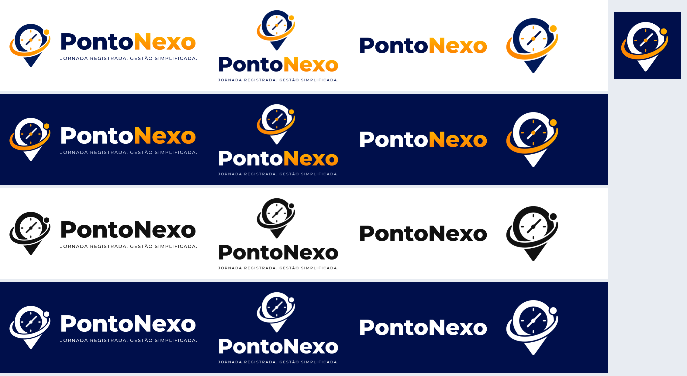

# PontoNexo — Identidade visual



## Conceito

Um **pino de localização** com um **relógio** dentro: o registro de jornada no lugar certo, na hora certa. A **órbita laranja** com o ponto liga os dois e representa o "nexo", a conexão entre funcionário, empregador e jornada. O nome em sem-serifa geométrica pesada divide **Ponto** (marinho) e **Nexo** (laranja). A tagline é **JORNADA REGISTRADA. GESTÃO SIMPLIFICADA.**

## Estrutura

```text
brand/
├── README.md               ← este guia
├── preview.png             ← folha com todas as versões
├── source/
│   ├── original/           ← logo original enviada (raster, não editar)
│   └── fonts/              ← Montserrat 500/700/800 (OFL), usada para converter o texto em curvas
├── svg/                    ← VETORES OFICIAIS (fonte da verdade)
│   ├── logo-horizontal/    ← versão principal
│   ├── logo-empilhado/     ← igual à original
│   ├── logotipo/
│   ├── simbolo/
│   └── icone-app/          ← ícone de app + maskable (PWA/Android)
├── png/                    ← exportações raster (geradas, não editar)
│   ├── logo-horizontal/  logo-empilhado/  logotipo/  simbolo/
│   ├── icone-app/          ← 1024/512/192, maskable 512/192, apple-touch-icon 180
│   ├── social/             ← Open Graph 1200×630, capa do LinkedIn, avatar 400
│   └── email/              ← assinatura de e-mail 600
└── favicon/                ← favicon.ico (16/32/48) + icon.svg (traço reforçado)
```

No app web, o script copia as peças para:

```text
apps/web/src/app/      favicon.ico · icon.svg · apple-icon.png · opengraph-image.png
apps/web/public/       icon.svg · icon-192.png · icon-512.png · icon-maskable-512.png
apps/web/public/brand/ pontonexo-logo-*.svg · pontonexo-logotipo*.svg · pontonexo-simbolo*.svg
```

## Versões

| Versão | Quando usar |
| --- | --- |
| **Logo horizontal** | **Padrão.** Menu do painel, cabeçalhos, documentos, e-mails |
| **Logo empilhado** | Espaços quadrados ou verticais: login, splash, apresentações |
| **Logotipo** | Quando o símbolo já aparece por perto, ou não há altura para ele |
| **Símbolo** | Cabeçalho do app no celular, avatar, marca d'água |
| **Ícone de app** | PWA, atalhos, lojas (símbolo branco sobre fundo marinho) |

Cada versão tem quatro variantes de cor:

| Sufixo | Fundo | Observação |
| --- | --- | --- |
| _(sem sufixo)_ | Claro | Colorida principal (com o degradê laranja da original) |
| `-fundo-escuro` | Escuro | Pino e "Ponto" em branco, laranja mantido |
| `-mono-preto` | Claro | Impressão em 1 cor, carimbo, gravação |
| `-mono-branco` | Escuro / foto | Sobre imagens ou fundos coloridos |

PNGs com fundo transparente, em várias larguras (sufixos `-512`, `-1024`, `-2048`; símbolo também `-128`, `-256`). Use SVG sempre que puder.

## Cores (amostradas da original)

| Nome | HEX | Uso |
| --- | --- | --- |
| Marinho do pino | `#001A5A` | Pino |
| Marinho do texto | `#000F4B` | "Ponto", tagline, fundo escuro, cor `marca` do sistema |
| Laranja claro → profundo | `#FFB000` → `#FD8601` | Órbita, ponto, marcadores, "Nexo" (degradê só na logo) |
| Laranja chapado | `#FE9A02` | Versões sem degradê, `marcador` do sistema |

A interface do sistema não usa degradê (guia visual); o degradê fica restrito à logo colorida.

## Regras de uso

- **Área de proteção:** espaço livre ao redor de pelo menos a altura do **N** de "Nexo".
- **Tamanho mínimo:** logo horizontal com 160 px (40 mm) de largura; símbolo com 28 px. Abaixo disso, use `favicon/icon.svg`, que tem traço reforçado e sem marcadores.
- **Não faça:** distorcer, girar, trocar as cores, separar a órbita do pino, aplicar sombra ou contorno, ou usar a colorida sobre fundo sem contraste (use a mono).

## Regenerar

```bash
pip install -r scripts/brand/requirements.txt   # fonttools + Pillow (ImageMagick 7 também é necessário)
pnpm brand:svg      # reconstrói os SVGs (svg/, favicon/icon.svg)
pnpm brand:export   # exporta PNGs, favicon.ico, peças sociais, preview e sincroniza o apps/web
```

> **Sobre os vetores:** a logo original existe só em raster. Os SVGs foram reconstruídos com geometria explícita (pino, relógio, órbita ajustada aos pontos da original) e o texto convertido em curvas da Montserrat. Se o designer entregar o vetor original (.ai, .svg ou .pdf), guarde-o em `source/original/` e substitua os SVGs.
